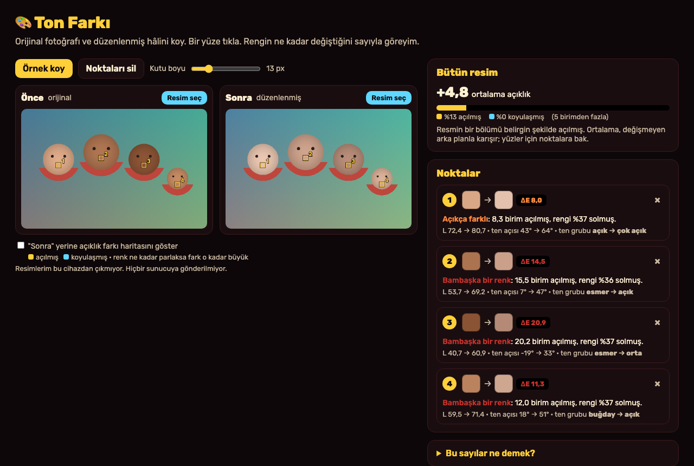
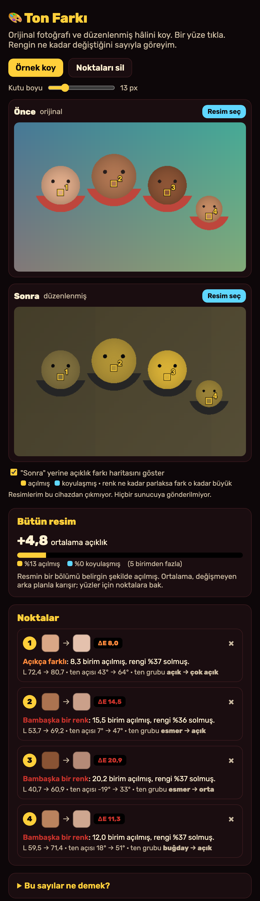

# Ton Farkı

Aklıma bu geldi: Bugün Reddit'te bir aile, Tayland'da tuttukları her fotoğrafçının bütün ailenin tenini fotoşopla bembeyaz yaptığını yazmıştı. "Uzaylı gibi görünüyoruz" diyordu. Ben de merak ettim: Bir fotoğrafın ne kadar beyazlatıldığını "bence biraz açılmış" demeden, sayıyla gösterebilir miyim? Ben bu aracı bunun için yaptım. Orijinal fotoğrafı ve düzenlenmiş hâlini koyuyorum, bir yüze tıklıyorum, rengin ne kadar değiştiğini görüyorum. Bu iki resim, benim çalıştırdığım uygulamanın gerçek ekranları.

## Ben nasıl kullanıyorum?

1. Ben bu klasörde `python3 -m http.server 8000` çalıştırıyorum. Sonra `http://localhost:8000` açıyorum.
2. Ben **Önce** kutusuna orijinal fotoğrafı, **Sonra** kutusuna düzenlenmiş fotoğrafı koyuyorum. "Resim seç" ile ya da sürükleyip bırakarak.
3. Ben bir yüze ya da cilde tıklıyorum. Aynı yer iki resimde de ölçülüyor. En fazla 6 nokta koyabiliyorum; × ile siliyorum.
4. Ben her nokta için iki renk kutusunu yan yana, **ΔE** farkını ve "kaç birim açılmış, yüzde kaç solmuş" yazısını görüyorum.
5. Ben **Kutu boyu** ile ölçtüğüm alanı büyütüp küçültüyorum. Büyük kutu gölge ve parlamaları ortalıyor.
6. Ben **açıklık farkı haritasını** açınca hangi yerlerin açıldığını (sarı) ya da koyulaştığını (mavi) bütün resimde görüyorum.

Ben "Örnek koy" ile hemen deneyebiliyorum. **Örnek resim uydurma**: dört yuvarlak çizim yüz, ikincisinde yüzleri kendi yazdığım bir "beyazlatma" filtresiyle açtım. Gerçek bir kişinin fotoğrafı değil.

## Ben içeride ne yaptım?

Ben her pikseli önce **CIELAB** renk uzayına çevirdim. Bu uzayda **L** açıklık (0 siyah, 100 beyaz), **a** ve **b** de rengin kendisi. RGB'de iki sayı arasındaki fark gözün gördüğü farka benzemiyor, Lab'de daha çok benziyor.

İki rengin farkını **CIEDE2000 (ΔE)** formülüyle hesapladım. Bu, renk biliminde "insan gözü bu iki rengi ne kadar farklı görür" sorusunun standart cevabı. Ben şöyle yorumluyorum: 2'nin altı gözle fark edilmez, 2–5 dikkatle bakınca görülür, 5–10 açıkça farklı, 10'un üstü bambaşka bir renk.

Cilt için bir de **ten açısı (ITA°)** hesapladım: `atan((L − 50) / b)`. Bu açı büyüdükçe cilt daha açık sayılıyor. Ben açıyı altı gruba ayırdım: çok açık, açık, orta, buğday, esmer, koyu. Böylece "esmer → açık" gibi bir grup kaymasını görebiliyorum.

Tıkladığım noktada tek piksele değil, çevresindeki kare kutunun ortalamasına bakıyorum. Tek piksel gürültülü olabiliyor.

İki resmin boyu farklıysa "Sonra" resmini "Önce" boyutuna getiriyorum ki aynı nokta aynı yere denk gelsin. En-boy oranı farklıysa beni uyarıyor, çünkü resim kırpılmışsa noktalar kayabilir.

Ben `core.mjs` içinde renk hesaplarını, `app.mjs` içinde ekranı tuttum. Resimlerim hiçbir sunucuya gitmiyor, sadece tarayıcının içinde işleniyor. Ben hesap ya da API anahtarı kullanmıyorum.

## Ben neyi sınadım?

Ben `node test.mjs` komutunu çalıştırdım. **65 kontrol** geçti.

- Beyaz, siyah, kırmızı ve gri için Lab değerleri bilinen sonuçlarla tuttu (kırmızı: L 53,24 · a 80,09 · b 67,20).
- Beş renk Lab'e gidip geri geldiğinde aynı RGB çıktı.
- CIEDE2000 için Sharma, Wu ve Dalal'ın 2005 makalesindeki test tablosundan **7 çifti** iki yönlü denedim; hepsi 4 basamağa kadar tuttu. Bu tablodaki çiftler formülün zor yerlerini (renk tonunun 0°/360° geçişi gibi) sınıyor.
- Uydurma örnekte dört yüzün hepsi açılmış ve solmuş çıktı, arka plan ise neredeyse aynı kaldı (ΔE 5'in altında).
- İlginç bir şey gördüm: **Aynı filtre koyu yüzü açık yüzden çok daha fazla değiştirdi.** En açık yüz ΔE 8,0 (açık → çok açık), en koyu yüz ΔE 20,9 (esmer → orta) oldu. Yani "herkese aynı filtreyi uyguladım" demek, herkesin aynı derecede değiştiği anlamına gelmiyor.

Ben uygulamayı tarayıcıda da açtım. Örnek, nokta ekleme, nokta silme, 6 nokta sınırı, kutu boyu, fark haritası, PNG dosyası yükleme, farklı en-boy oranı uyarısı ve bozuk dosya uyarısı çalıştı. Telefon boyutunda (375 piksel) sayfa yana taşmadı.

Denerken bir hata yakaladım: Mavi arka plana tıklayınca ten açısı -177°'den 172°'ye zıplıyor ve "koyu → çok açık" diyordu. Ten açısı sadece cilde benzeyen renklerde anlamlı. Şimdi rengin tonu sarı-kırmızı arasında değilse ten grubunu hiç göstermiyorum. Bunun için de test yazdım.

Benim sınırlarım var. Bu araç bir kişinin gerçek ten rengini söylemez; ışık, kamera ve ekran sayıları değiştirir. Sadece **aynı fotoğrafın iki hâlini** karşılaştırır. İki resim farklı anlardan çekilmişse fark düzenlemeden değil, ışıktan gelebilir. Resim kırpılmış ya da kaydırılmışsa noktalar aynı yere denk gelmeyebilir; ben henüz iki resmi otomatik hizalamıyorum. İleride bunu eklemek isterim.

## Ben bunları nereden öğrendim?

- CIEDE2000 formülü ve test tablosu: G. Sharma, W. Wu, E. N. Dalal, "The CIEDE2000 color-difference formula: Implementation notes, supplementary test data, and mathematical observations", *Color Research & Application* 30(1), 2005.
- sRGB'den Lab'e çevirme: sRGB standardı (IEC 61966-2-1) ve D65 beyaz noktası.
- Ten açısı (ITA°): A. Chardon, I. Cretois, C. Hourseau, "Skin colour typology and suntanning pathways", *International Journal of Cosmetic Science* 13(4), 1991. Altı grubun sınırlarını (55°, 41°, 28°, 10°, −30°) bu açıyı kullanan sonraki cilt rengi çalışmalarında (ör. Del Bino ve arkadaşları, 2006) yaygın kullanılan hâliyle aldım.

## Ben bugünün kaynaklarına nasıl baktım?

Ben 29 Ekim 2026 saat 23.06 Türkiye vaktinde [GitHub Trending günlük listesine](https://github.com/trending?since=daily) baktım. Gördüğüm 11 repo arasında ilk sırada [HKUDS/DeepTutor](https://github.com/HKUDS/DeepTutor) vardı ve "bugün 1.926 yıldız" yazıyordu. Bu, bütün GitHub'ın kesin birincisi olduğu anlamına gelmez. Ben onların kodunu kopyalamadım.

Ben aynı anda [Trends24 dünya listesinde](https://trends24.in/) `#النصر_الخلود` etiketini ilk sırada gördüm, ikinci sırada `Game 7` vardı. Bu liste üçüncü taraf bir anlık görünümdür; bütün günün kesin en çok konuşulan konusu demem. Projeme zorla eklemedim.

Ben [Reddit r/popular Top/Today listesinde](https://www.reddit.com/r/popular/top/?t=day) ilk sırada r/interesting'deki ["Mexico upgraded to free health care!"](https://www.reddit.com/r/interesting/comments/1xiafkr/mexico_upgraded_to_free_health_care/) gönderisini gördüm. Aynı listede r/mildlyinfuriating'de [fotoğrafçıların ailenin tenini fotoşopla beyazlattığını anlatan gönderi](https://www.reddit.com/r/mildlyinfuriating/comments/1xi7y1t/every_time_i_try_to_hire_a_photographer_in/) vardı. Benim fikrim buradan çıktı. Bu tek görünüm, bütün Reddit'in en çok konuşulan konusunu kanıtlamaz.

Ben bu projeyi MIT lisansı ile paylaşıyorum.
